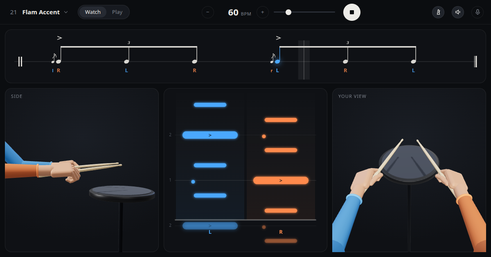

# Drum Rudiments Trainer

All 40 PAS drum rudiments on one practice pad: two hands in 3D, a note lane and the notation, from 10 to 240 bpm, with a play-along score.

**[micahchoo.github.io/drum-rudiments](https://micahchoo.github.io/drum-rudiments/)**



- **Watch** shows a rudiment. Every rudiment has its own page, e.g. [Single Paradiddle](https://micahchoo.github.io/drum-rudiments/single-paradiddle/).
- **Play** counts you in and listens through the microphone. It scores each hit for timing, accents against your own taps, and flam spread. It hears when and how hard, not which hand.
- Slow strokes turn the wrist and fast ones turn the stick in the fingers. After each stroke the stick goes to the height of that hand's next stroke, which gives the full, down, tap and up strokes.

## Develop

```sh
bun install
bunx vite          # http://localhost:5173/drum-rudiments/
bun run check      # tests, types, build
```

`CONTEXT.md` defines the terms the code uses. Pushing to `main` deploys to GitHub Pages.

Rudiment list: [Percussive Arts Society](https://pas.org/rudiments/).
